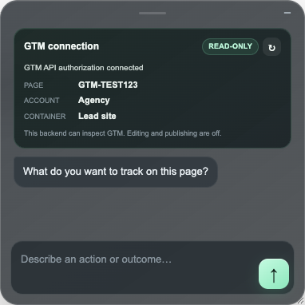

# Trimtale

**Prove that your site's tracking fires: set up GA4 events through Google Tag Manager and check each one against what the browser actually sends.**

[Quick start](#quick-start) · [What it does](#what-it-does) · [Known limits](#known-limits) · [Privacy](#privacy-and-permissions) · [Docs](docs/)

Trimtale is a Chrome extension and small API for analytics consultants and marketers who
set up tracking on lead-generation sites and need proof that it works. It finds the links
and forms on the page you're on, generates the GTM setup for a navigation click or a lead
form, and then records whether a real click or submission produced exactly one matching
GA4 collection request. Every step reports its own evidence, so "setup generated", "container
detected" and "request seen in the browser" stay separate claims. Seeing a request leave the
browser is browser evidence only; it does not prove that GA4 processed it.

Sailors trim their sails by watching the telltales, the short ribbons that show whether air is
flowing the way it should. Trimtale is meant to be the telltale for your tracking.

<p align="center">
  
</p>

<p align="center"><sub>Real extension runs on the bundled fixture site, whose stand-in GA4 tag sends requests to the fixture itself; no Google account or network call is involved. A captured request is browser evidence: it shows what left the browser, not what GA4 processed.</sub></p>

## Quick start

Requires Node.js 22+ and npm 10+. Not published on the Chrome Web Store; you load it unpacked.

```bash
npm ci
npx playwright install chromium   # only needed for the browser tests
npm run build
npm run dev:api        # terminal 1: local API on http://127.0.0.1:18787
npm run dev:fixture    # terminal 2: sample site on http://127.0.0.1:14173
```

Then in Chrome, open `chrome://extensions`, turn on **Developer mode**, click **Load unpacked**
and choose `apps/extension/dist`. Open `http://127.0.0.1:14173`, press **Cmd+Shift+Y**
(**Ctrl+Shift+Y** on Windows/Linux) and type `navigation` or
`Track successful submissions of this form`. The assistant highlights the matching targets on the sample
site and walks you through confirming them and generating the GTM setup.

To run the full check suite (types, unit tests, build, and the browser tests in a managed
Chromium), use `npm run verify`.

## What it does

| Step | What Trimtale does |
|---|---|
| Understand the request | Classifies a navigation-click or lead-form request. Classification is deterministic; no AI model decides anything today. |
| Find the targets | Discovers links and forms on the current page, highlights candidates and keeps only the ones you confirm. |
| Generate the setup | Builds a GTM container file: one GA4 event tag (`navigation_click` or `generate_lead` with `form_id`, `form_name`, `page_location`), its trigger and variables. Downloads as `trimtale-navigation-click.json` or `trimtale-generate-lead.json`. |
| Detect the container | Reads public `GTM-` IDs from the page's script URLs and, with Google connected, matches one to exactly one container your account can access. |
| Prepare a workspace | With container writes switched on, creates or reuses one managed custom workspace, applies the setup, validates it and creates an immutable GTM version. |
| Verify in the browser | Watches what the browser actually does when you click or submit (the submit and validation events, the success message or thank-you page, `dataLayer` events, Consent Mode state, and GA4 requests and whether they were delivered) and classifies the result: verified, expected validation failure, missing event, tag did not fire, missing request, missing parameter, duplicate request, consent-limited, server error, or not enough evidence. |
| Publish and roll back | Publishing and rollback exist behind an exact version-fingerprint approval and a separate backend switch. They are off by default and are never run by CI or `npm run verify`. |

<p align="center">
  
</p>

<p align="center"><sub>Container detection on the bundled fixture site, with a stubbed read-only Google connection.</sub></p>

## Known limits

- **Lead-form verdicts come from real browser signals**, but they've only been exercised
  on the bundled fixture site, not on a live production site yet. Signals Trimtale can't see:
  GA4 events batched into a POST body (only the request URL's event name is read), a form
  endpoint response whose body the page never reads, and forms inside cross-origin iframes.
  When the server's answer and the page disagree, the server wins: a page that says "Thanks"
  after its form endpoint returned 503 is reported as a failed submission. That only works for
  requests to the origin the form submits to; a failure on another origin (say a separate API
  subdomain the form's `action` doesn't name) can't overrule a success message.
- **Verification is tied to setup.** You can't yet point Trimtale at tracking that already
  exists and get a verdict without generating a setup first. A read-only check mode is planned.
- **Only GA4 collection requests are captured**, from `*.google-analytics.com` and
  `analytics.google.com`. Server-side GTM, first-party collection domains, Google Ads
  conversions and non-Google pixels aren't seen yet.
- **No scheduled re-checks.** Each verification is a one-off browser run.
- **GTM and GA4 only.** Other tag managers and analytics platforms aren't supported.
- The managed GTM workspace is still named `GTM Observability` (the product's earlier name),
  because that name and its ownership marker identify workspaces already created in real
  containers.

## Privacy and permissions

Trimtale never sends form field values, cookies, local storage or page HTML anywhere. Once
you start a form verification, a small observer inside the page reads `window.dataLayer` and
passes only event names, `form_id`/`form_name` identifiers and consent states to the
extension; it never reads form field values. What does leave the browser:

- **To the Trimtale API** (local `127.0.0.1:18787` by default, or the hosted API you build
  against): the tracking intent, page URL, detected public GTM and GA4 IDs, and the confirmed
  link text, URL, area and selector. Lead-form verification evidence keeps only an allowlisted
  part of each GA4 request (measurement ID, event name, `form_id`, `form_name`, and the page
  URL without its query string), never what people typed into the form.
- **To Google**, only if you configure OAuth on the API: Tag Manager API calls made by the API
  server. Without OAuth the Google routes are disabled.

| Permission | Why |
|---|---|
| `activeTab`, `scripting` | Inject the assistant into the page you opened it on. |
| `storage` | Remember the panel position and, per site, the detected GTM and GA4 IDs. |
| `webRequest` | Observe GA4 collection requests as verification evidence. |
| Host access to the API origin, `*.google-analytics.com`, `analytics.google.com` | Call the API and observe GA4 requests. |

More detail: [Security and publishing notes](docs/security-and-publishing.md).

## How it works

| Part | Role |
|---|---|
| `apps/extension` | Chrome MV3 extension: the on-page assistant, target discovery, evidence capture. |
| `apps/api` | Node API: setup generation, Google OAuth, GTM reads and writes, the durable setup operation. |
| `packages/core` | Domain logic: tracking specs, the GTM generator, the deterministic form verdict engine, change planning. |
| `apps/fixture-site` | The sample "Northstar" lead-gen site with 18 form scenarios used by the browser tests. |
| `apps/verification-target` | A disposable smoke-test page for credentialed runs. |

The product plan and current status live in [`docs/product-plan/`](docs/product-plan/), starting
with [What Trimtale has today](docs/product-plan/current-capabilities.md).

## Development

`npm run verify` is the completion gate: strict TypeScript checks, the unit and scenario
tests, every workspace build, and the Playwright browser tests with the extension loaded.
It uses only local fixture services and never calls Google. CI runs the same command on
every pull request.

The agent command harness, Google OAuth setup, container-write and publication switches, and
hosted API builds are documented in [Local development](docs/engineering/local-development.md)
and the [GTM setup workflow runbook](docs/engineering/gtm-workflow-runbook.md). Contributors
and agents follow [AGENTS.md](AGENTS.md).

## License

Trimtale is licensed under the [GNU Affero General Public License v3.0](LICENSE). You can use,
change and self-host it; if you run a modified version as a network service, you must offer
its users the source of your changes.
